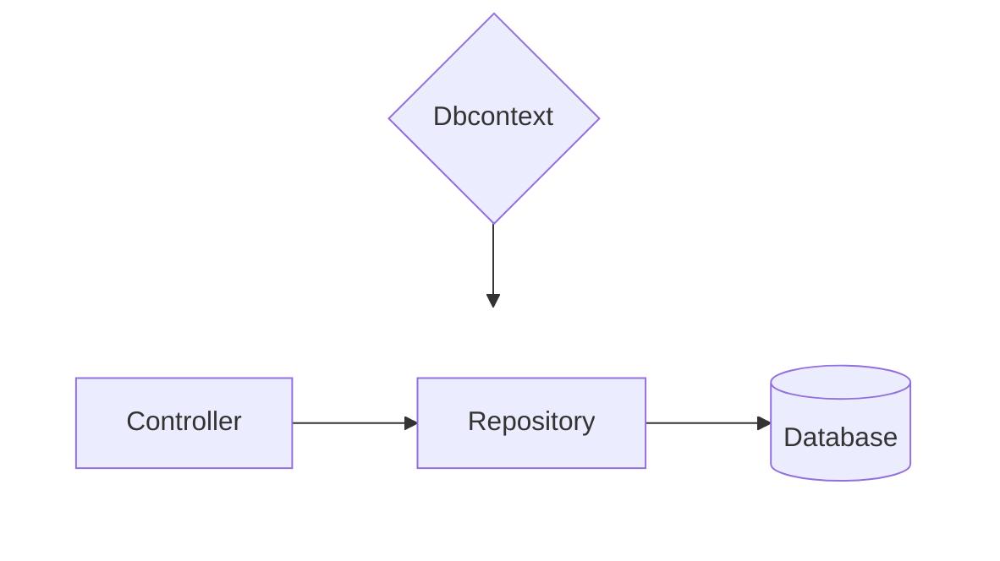

## DTOs
Data Transfer Objects
- Use to transfer data between different layers of an application
- Typically contain a subset of the properties in the domain model
- For example transferring data over a network

#### Advantage of DTOs
1. Separation of concerns
2. Performance
3. Security
4. Versioning

---

## Asynchronous Programming
Allows the program to continue executing other tasks while waiting for long running operation to complete, resulting in a much better performance and responsiveness.
This means that long running operations such as database queries, file operations and etc, will be executed without blocking the main thread, allowing the application to continue responding to user requests.

- Traditional Syncronous programming - program execution is blocked
- Poor performance (Synchronous programming) 
- ```Async/await``` keywords
- More requests

---

## Repository Pattern

It's a design pattern to separate the data access layer from the application.
- It also provides a standard **interface** which is a  ```interface``` class for accessing and managing data in the database without exposing the underlying implementation detail to the rest of the application.
- It helps create abstraction. Repository pattern typically involves creating an abstraction layer between the application and the data store, which is implemented by a concrete repository class. The repository class is responsible for perfoming CRUD operations on the data-store(Database) and it exposes a set of methods that the application can use to interact with the data.



- Repositories can be added in between the controller and the database so that all the operations on the database is then handled by the repository.
- The ```DbContext``` class is injected inside the **Repository** rather than inside the ```Controller```, And then it is the **Repository** that then injects in the ```Controller```.

#### Benefits
1. **Decoupling** the data access layer from the rest of the app, which make it easier to maintain and test the app.
2. **Consistency**: providing a standard interface for accessing data which improves the consistency and readability of the code.
3. **Performance**: We can always improve the performance of the code by using caching, batching or ...
4. **Multiple data sources (switching)**: which allows the application to switch between different data sources without affecting the application logic.

---

## AutoMapper

**AutoMapper** is a .NET library that maps data between objects, such as database entities (or Domain Models and View Models) and DTOs, using matching property names and configurable rules.
With help of **AutoMapper** you can create mappings between the source and destination objects in a centralized location which can be used throughout your application.
This reduces the need for manually copying values between objects, and you can help to make your code more maintainable and error prone.
It can be intergrated into you app using NuGet packages and configuared using its fluent Api.

Define mapping with ```CreateMap<Source, Destination>()```, then use ```IMapper``` to perform them.

- Object-to-object mapping
- Simplification
- Map between DTOs and Domain Models and Vice-versa
- Quite powerful apart from just simple object-to-object mapping

### Basic Usage

To use AutoMapper, follow these steps:

1. Install AutoMapper: Use NuGet to add AutoMapper to your project.
```
bash

dotnet add package AutoMapper
```

2. Define Mappings: Create a mapping configuration using ```CreateMap<Source, Destination>()```.
```
csharp

var config = new MapperConfiguration(cfg => 
{
    cfg.CreateMap<SourceClass, DestinationClass>();
});
```
3. Perform Mapping: Use the ```IMapper``` interface to execute the mapping.

```
csharp

var mapper = config.CreateMapper();
var destinationObject = mapper.Map<DestinationClass>(sourceObject);
```

---

## Navigation Properties
In Entity Framework, navigation properties are properties that allow us to navigate from one domain model to another.
or also from one entity to another entity in a relational database.
1. Navigation properties are used to define relationships between entities, such as one-to-many, many-to-many, and one-to-one relationships.
2. Navigation properties are defined as properties in a C# class that represent the related entity or collection of entities.
3. Navigation properties are typically defined using the ```virtual``` keyword, which allows Entity Framework to create a proxy class that can be used to lazy load related entities.
4. They are typically defined in a form of an object or a collection of objects that reference another entity or collection of entities.

### Example
If you have a ```Walk``` entity that has a relationship with a ```Difficulty``` entity and a ```Region``` entity, you can define navigation properties in the ```Walk``` class to allow you to navigate to the related entities:

```
csharp
public class Walk
    {
        public Guid Id { get; set; }
        public string Name { get; set; }
        public string Description { get; set; }
        public double LengthInKm { get; set; }
        public string? WalkImageUrl { get; set; }

        public Guid DifficultyId { get; set; }
        public Guid RegionId { get; set; }

        // Navigation Properties
        public Difficulty Difficulty { get; set; }
        public Region Region { get; set; }
    }
```
