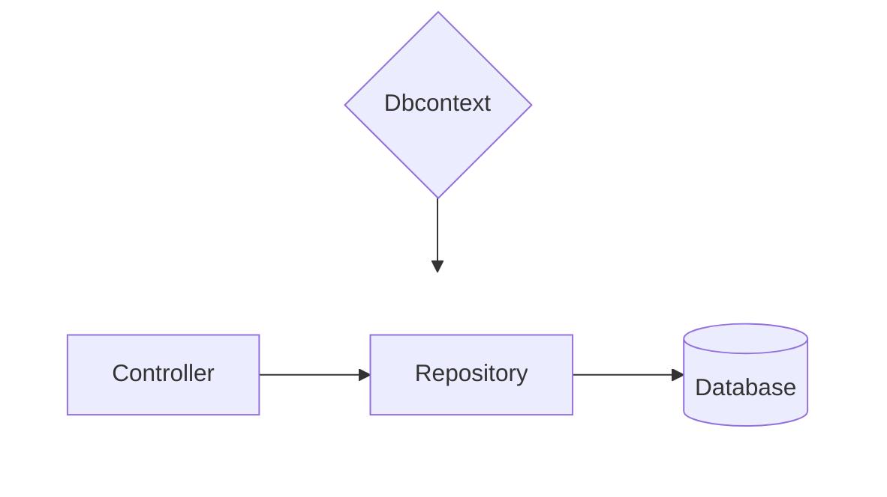

## DTOs
Data Transfer Objects
- Use to transfer data between different layers of an application
- Typically contain a subset of the properties in the domain model
- For example transferring data over a network

#### Advantage of DTOs
1. Separation of concerns
2. Performance
3. Security
4. Versioning

---

## Asynchronous Programming
Allows the program to continue executing other tasks while waiting for long running operation to complete, resulting in a much better performance and responsiveness.
This means that long running operations such as database queries, file operations and etc, will be executed without blocking the main thread, allowing the application to continue responding to user requests.

- Traditional Syncronous programming - program execution is blocked
- Poor performance (Synchronous programming) 
- ```Async/await``` keywords
- More requests

---

## Repository Pattern

It's a design pattern to separate the data access layer from the application.
- It also provides a standard **interface** which is a  ```interface``` class for accessing and managing data in the database without exposing the underlying implementation detail to the rest of the application.
- It helps create abstraction. Repository pattern typically involves creating an abstraction layer between the application and the data store, which is implemented by a concrete repository class. The repository class is responsible for perfoming CRUD operations on the data-store(Database) and it exposes a set of methods that the application can use to interact with the data.



- Repositories can be added in between the controller and the database so that all the operations on the database is then handled by the repository.
- The ```DbContext``` class is injected inside the **Repository** rather than inside the ```Controller```, And then it is the **Repository** that then injects in the ```Controller```.

#### Benefits
1. **Decoupling** the data access layer from the rest of the app, which make it easier to maintain and test the app.
2. **Consistency**: providing a standard interface for accessing data which improves the consistency and readability of the code.
3. **Performance**: We can always improve the performance of the code by using caching, batching or ...
4. **Multiple data sources (switching)**: which allows the application to switch between different data sources without affecting the application logic.

